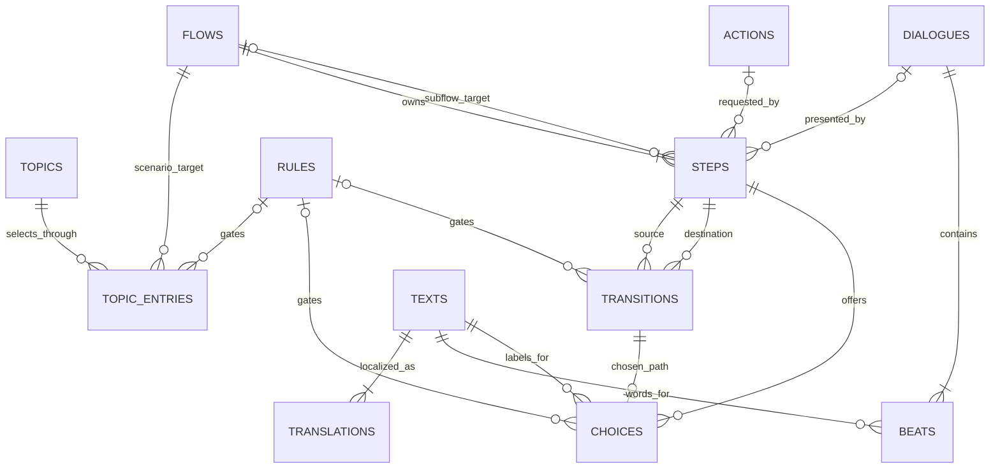
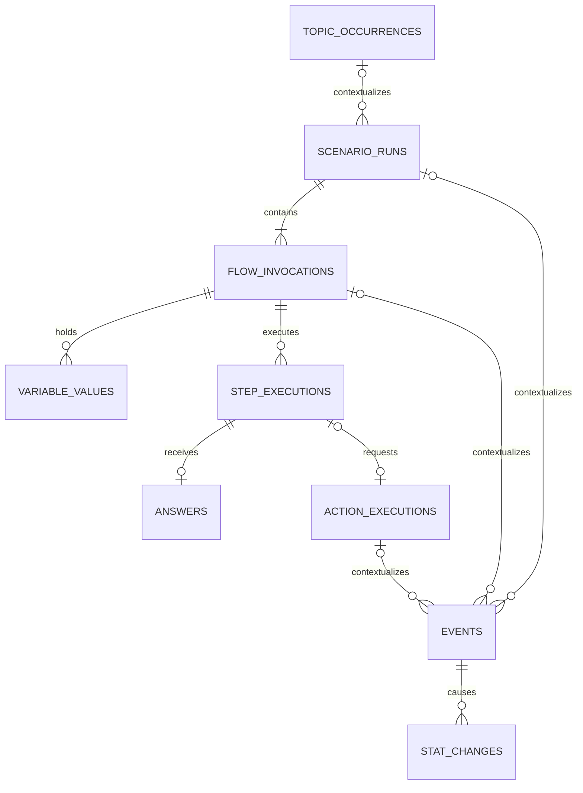
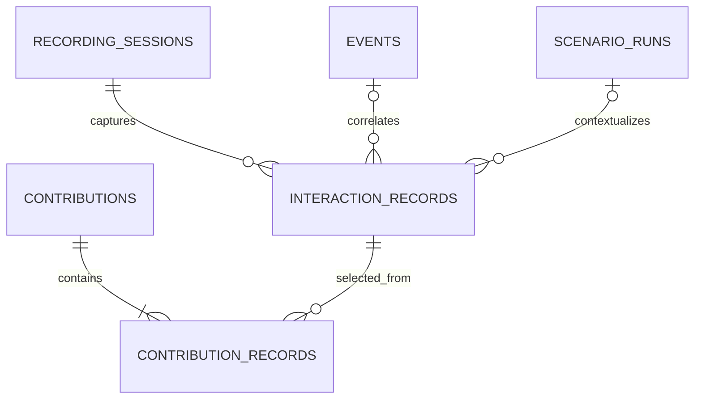

# Content and interaction ERD

Related: [[Dialogue and Semantic Storage Design]], [[Data Management Design]],
[[Data Management Implementation Plan]], [[Topic Scenario Activity Technical Reference]],
[[Content Workbench Shared Contract]], [[Player Memory Design]].

## Purpose, authority and scope

Full-migration approval2026-10-22: [[Full SQLite Cutover Implementation Plan]] now
requires SQL runtime authority for supported content/embeddings, generated archive,
Topic consumption, conversation sessions/repetition and chat transcript, with explicit
one-time imports. Earlier no-history-migration/optional-source scope below is historical
and superseded by that amendment. Memory remains its existing separate SQLite owner;
credentials remain secure storage. No private-profile migration was executed here.

This is the consolidated relationship map for the approved brainstorming decisions.
It replaces the early table-name sketches in [[Dialogue and Semantic Storage Design]]
as the current ERD entry point. That note remains the decision journal/research.
Human approved this consolidated model2026-10-21 and asked to finalize it, then
await the Database Management System session's report before requesting integration.
The definition/reuse, logical relationships, naming direction and ownership/privacy
boundaries are the approved baseline. Exact SQLite DDL, retention constants and
compatibility adapters remain gated by the completed foundation; approval is not
proof of a migration, renderer check or runtime implementation.

Organize by three domains: reusable content; execution/gameplay history; optional
recording/contributions. Semantic indexing is a supporting part of content. Do not
merge these into a universal arbitrary-data table merely to reduce table count.

The existing Database Management System session owns D0-D6 only. It does not own
this content/telemetry migration. No schema/runtime changes, captured personal data,
uploads, provider calls or worker-scope expansion result from this document.

Execution follow-up2026-10-21: the human subsequently requested a coordinator-written
implementation plan and continuous execution by that same session. The bounded
[[Content Data Integration Implementation Plan]] P0-P9 was created/self-reviewed and
sent as START. This explicit later task extends the worker beyond completed D0-D6;
the paragraph above records the original consolidation boundary, not current scope.
No full-application memory/transcript merge, live capture/UI, upload service or
training is authorized by that plan. Production cutover remains acceptance-gated.

## SQLite authoring authority approved 2026-10-22

The human approved this boundary: SQLite owns authored dialogue content and
editable drafts; JSON is explicit import/export only. This supersedes earlier
JSON-as-editable-source target wording. The Workbench commands and Editor build
processor now use the revisioned authoring repository and the explicit `default`
build set. The local store and deterministic review export contain all 439 current
Dialogue sources; headless command/repository/content checks pass. The installed
runtime artifact passed read-only integrity, foreign-key and trusted-release
inspection, and its manifest snapshot matches authoring revision 63. Unity startup
and player acceptance remain unverified. The required authoring UI is a Flow-first
graph with a selected-step writing inspector, using the same typed commands as
agents. W1 command backend is present; graphical W2-W3, preview/parity W4 and
acceptance W5 remain open in the existing Workbench plan. See
[[../Verification/2026-10-22 SQLite Authoring Core]],
[[SQLite Authoring Cutover Implementation Plan]] and
[[../Verification/2026-10-22 Full SQLite Cutover]].

- Workbench and agent CLI share one authoring repository and typed commands.
  Editing database files with arbitrary SQL is not the supported authoring API.
- Incomplete drafts may be saved/inspected with diagnostics. Bounded JSON inside
  a SQL draft record is allowed; it never replaces the existing normalized
  published Topics/Flows/Dialogues/Beats/Texts/Actions/Rules model.
- Draft save, validation, snapshot compilation, publication and runtime installation
  are distinct operations. Only a validated immutable release is executable;
  running conversations keep their pinned revisions until they finish.
- JSON imports are deliberate, hash/CAS checked and receipt-backed. Preserve IDs,
  languages, branches, unknown fields and original bytes. Repeated import cannot
  overwrite newer SQL edits. No permanent dual-authority file synchronization.
- Readable deterministic exports support Git review and explicit fresh-clone
  bootstrap. Exports are not a second live store and cannot silently recreate a
  corrupt/missing canonical database. Preserve original files until separately
  approved removal after round-trip/recovery acceptance.
- Authoring, shipped read-only runtime content, private generated content and
  player memories/conversations keep separate ownership. SQLite does not mean one
  universal database, storing model/audio/Unity assets in SQL, or new LLM powers.
- The installed catalogue artifact is present and read-only verified. Corrected Unity
  tests, `SplashScene -> ModelTest`, player acceptance and safe-profile migration checks
  remain open. This approval adds no automatic publication, API spend or real-profile
  migration.

## Current compiled-content implementation (2026-10-23)

The current authoring database uses schema 1 at store revision 63, with 439 imported
source documents in the explicit `default` build set. W1 exposes typed
`authoring.read`/`authoring.write` commands through the JSON stdin/stdout CLI. The
approved human UI uses those same commands in a Flow-first graph and selected-step
writing inspector. W2-W5 remain open; the CLI backend alone is not the completed
human editing experience. The contract and plan are in
[[Content Workbench Shared Contract]] and [[Content Workbench Implementation Plan]].

The installed immutable runtime release remains compiled-content schema v4 and a
schema-2 build manifest. Its inspected snapshot contains 57 Topics, 322 Flows, 928
Dialogues, 1,258 Texts, 6,041 release dependencies, and 673 anchors/embeddings; the
semantic index has 57 routes and 768 dimensions. These counts describe this release,
not permanent schema limits. Its manifest points to the exact current authoring
snapshot; see [[../Verification/2026-10-22 Full SQLite Cutover]].

The DBMS compiled-content source schema now migrates v4→v5→v6. Read-only v4/v5 stores remain
supported; writable opens upgrade through v6. Schema v6 adds `host_effect` Steps
with pinned Action refs and strict v1 prerequisite data, plus Furniture function
contract keys `(functionId,pointId,useId)`. The installed v4 artifact has not been
rebuilt or replaced; main review, Editor build/import and live acceptance remain
open. See [[../Verification/2026-10-23 Reusable Storage W1B]].

The separate game-history SQLite schema migrates v4→v5 to add exact Flow store ID,
revision, and content hash to each newly recorded Flow invocation. Existing v4 rows
receive blank pins and remain non-authorizing for new host effects. Scenario evidence
reads include the pinned Flow ref and both execution IDs; Furniture power commit and
replay paths verify run→invocation→step ancestry. The full synthetic persistence suite
passed 29/29 on 2026-10-23. This change does not advance or rewrite the installed
compiled-content artifact.

The installed v4 schema includes revisioned `actions` records with `id`, `revision`,
a `capabilityId` and bounded `contractJson`. W1B source schema v6 adds trusted
`activity_sequence` recipes normalized by the Activities-owned primitive/composer
catalog, plus pinned reusable Action references on Scenario Steps. Those rows select
host code; they never install executable C# or grant a content-authored capability.
The current Activity executor remains Movement/Drink-specific while the approved
reusable executor integration and TV/Locate/Fetch proofs remain pending. An authored
record cannot bypass furniture availability, reservations or Activity ownership.

## Shared conventions

- Definitions have stable namespace-qualified IDs and immutable published revisions.
  Proposed local identity key: `(id, revision)`; owned children additionally use their
  parent revision and a local child ID. Never use menu labels as identity.
- Keep published content separate from drafts. New publication updates new callers;
  existing runs pin a validated release/dependency snapshot until they end.
- One role per table; reuse common content structures across authored/personal
  databases, not their mutable runtime state. Proposed files remain content.sqlite3,
  personal-content.sqlite3 and the game DB; recording storage is a logical domain,
  not a requirement for another SQLite file.
- Ordinary FK relationships are enforced inside one database with foreign-key checks
  enabled on every connection. Cross-store references carry explicit store namespace,
  definition ID/revision and bundle hash and are validated by the host. No claimed
  cross-file SQLite FK, silent fallback to another revision, or model-chosen file path.
- UTC timestamps describe time; revisions and operation IDs establish ordering/retry
  semantics. Unknown evidence is distinct from null optional value, zero or false.
- Same IDs across content and runtime denote references, never shared execution state.
  Use explicit FK/delete policies; do not cascade deletion from content or temporary
  frames into permanent history. Existing actor IDs/JSON contracts need adapters,
  not renaming in place.

## A. Reusable content definitions

Cardinality drawings show optional kind-specific relationships. They do not imply
every Step has a Dialogue, Action and Subflow simultaneously. Text/translation
minimum counts apply to publishable content; incomplete drafts are allowed but
cannot be played. All optional references must satisfy their Step kind contract.

| Compiled-content relation (source schema v6; installed artifact schema v4) | Key / main references | Owns |
| --- | --- | --- |
| metadata | singleton schema/build identity | Schema version, compiled-content/index fingerprint; not another Topic list |
| topics | id + revision | Semantic identity, title/prompt text refs, replay/cooldown definitions |
| topic_entries | Topic revision + entry_id; exact Scenario Flow revision | Selection conditions, priority, base weight/modifiers; replaces ambiguous content-variant use of scenario |
| flows | id + revision; kind=scenario/subflow | Entry Step, reusable graph identity; never an active run |
| steps | Flow revision + step_id | Kind and exclusive typed Dialogue/Action/host_effect/Subflow references or wait/branch/end data; host_effect v1 requires an earlier completed Dialogue gate |
| transitions | Flow revision + transition_id; source/target Step | Explicit within-Flow graph edges; branch/default/cancel/failure routes |
| choices | Flow revision + Step + choice_id; transition | Player answer value, label Text ref, availability Rule and locked-hint Text ref |
| dialogues | id + revision | Reusable bounded ordered VN sequence, independent of caller successors |
| beats | Dialogue revision + beat_id; unique sequence order | Text ref, supported expression/presentation; not effect execution |
| texts | id + revision | Reusable text resource identity shared by beats, titles, labels and hints |
| translations | Text revision + language | Text value; language is en/ja/id/etc, not language-named columns |
| actions | id + revision; registered capability key | Typed parameter/result contract, requirements and possible outcomes; no executable code |
| action_sequence_steps | Action revision + step_id; unique ordinal | Trusted-builder normalized primitives, typed arguments/results, three edges and checkpoint policy |
| items | id + revision; display Text ref | Stack limit and immutable Item definition |
| furniture_definitions | id + revision; display Text ref | Full versioned Furniture definition JSON, including functional and presentation bindings |
| furniture_function_bindings | Furniture revision + function/point/use | Host-registered contract version and contract JSON for the exact functional point/use |
| rules | id + revision | Shared typed condition expression; true/false/unknown with diagnostics |
| legacy_sources | source kind + relative source path + raw-byte hash | Stable legacy ID, exact compiled target ID/revision, and bounded source-specific metadata; changed bytes at one path retain separate mappings and the source file remains untouched |
| release_dependencies | Release + kind + exact ID/revision + store | Immutable typed dependency closure, expected content hash and row hash; cross-store refs stay host-resolved |

`texts`/`translations` is the proposed consolidation of beat_texts and owner-specific
label/title tables. Owner records reference a real Text key, avoiding arbitrary
owner_type/owner_id links. Shared text edits follow the same reference/publication
policy; Make independent copy explicitly creates a new resource identity.

### Conditions, parameters and calls

| Compiled-content structure (schema v4) | Relationship and invariant |
| --- | --- |
| flow_parameters | Flow revision + parameter name + direction; type/default/required; input/output names are unambiguous |
| flow_variables | Flow revision + local name; supported type/default/mutability; no collision with parameter names; declaration only, no shared runtime value |
| step_bindings | Call/Action Step + destination parameter; exactly one typed literal/caller variable/permitted host fact/earlier result source |
| flow_exits | Subflow revision + named exit; explicit output contract |
| exit_mappings | Call Step + callee exit; target caller transition and output-to-local mappings |
| Rule expression | Versioned bounded typed tree using all/any/not and supported comparisons; inline tree OR shared Rule ref, never both |

These structures are present in the compiled-content schema v4. Action
parameter/result specifications remain bounded structured contract data on an
`actions` record; the validator checks Step bindings against that contract. A Step can
only bind parameters permitted by its referenced contract. No SQL, arbitrary
expressions, caller-private access from a Subflow, or value binding that grants
capabilities.

Missing required bindings, wrong types, undeclared outputs and unmapped exits fail
publication. Caller transitions stay in the caller graph; returns use declared
exit ports. Subflows return only exit-valid outputs atomically; cancellation never
leaks partially produced values. Entity references are checked again when used.
Local references resolve against flow_variables for the exact caller revision;
dynamic undeclared variable names are rejected. A Subflow's inputs/outputs are its
public contract, not permission to access another invocation's local declarations.

Rule composition, Subflow calls and automatic transitions are bounded and validated;
no recursive definition calls/cycles in Rule references. Visible player-wait loops
are not arbitrary CPU loops. Exact limits must reconcile current validator bounds
before implementation rather than silently loosen them through nesting.

Only game executors implement Actions. Draft content may name an unsupported Action
for authoring diagnostics, but cannot publish it as executable. Action acceptance,
physical completion and stat checkpoints are distinct trusted results. Questions
belong to Steps; Dialogue supplies speech, not hidden tool/stat instructions.

### Localization and publication

Display and speech settings select translations independently, default en display /
ja speech. Missing display translation falls back to en; missing selected speech
means no speech, never an automatic translation bill. Missing en display fallback
is an authoring/unavailable diagnostic (proposed safe default). Language availability
does not imply a particular TTS adapter supports it. Cache finalized text, language
and voice/provider identity; existing bilingual contracts require explicit adapters.

Proposed `releases` records identify validated dependency bundles: draft/published
revision, content hash, validator version and pinned semantic snapshot. Membership
must resolve exact typed definition revisions (including reusable dependencies),
not just the top-level Topic ID. The 2026-10-22 P2 implementation uses normalized
`release_dependencies` rows plus a bounded JSON release header. The initial 218-file
Generic/Topic bake's explicit JSON dependency array measured 600,377 characters,
over the 262,144-character manifest bound; `ReadRelease` now verifies each dependency
row hash and the complete graph fingerprint. Consumers obtain exact membership through
the repository API rather than parsing an oversized header. A run
must resolve all dependencies deterministically before start; no floating latest.
Authored release is one compiled build initially; generated release may be smaller.
Shared text-only updates reach new callers after publish; changing exit/parameter
contracts requires validating all affected references. Retain referenced versions.
Exact revision FKs require the compiler to emit new dependent revisions throughout
the changed reference closure, including parent Dialogue/Flow/Topic references.
A new release cannot silently retarget an unchanged immutable caller row. Authored
source can retain friendly stable-ID references; compilation resolves them to exact
revisions. The tool should show affected callers before publication.

### Semantic support tables

| Proposed table | Key and role |
| --- | --- |
| anchors | Immutable content-addressed anchor_id; text/language/hash, reusable across supported targets |
| anchor_links | Link ID; anchor plus typed Topic/Intent/Tone/local target and role; exact owner revision validated |
| embedding_profiles | Immutable profile_id; model revision, tokenizer/pipeline hashes, dimension/dtype/normalization/metric |
| embeddings | anchor_id + profile_id; vector BLOB/hash, expected byte count and finite-value validation |
| jobs | job_id and idempotency key; bounded generation/validation/embedding work; private writable store only |

`anchor_links` discriminated target columns must have exactly one target and real
local FK where possible. Canonical vocabulary/cross-store owners require explicit
validated references; no arbitrary type string as permission. Local-anchor precedence
and local-only Topics remain supported by existing selection policy.
Float32 little-endian vector storage initially preserves the current matcher. Wrong
profile/source hash invalidates derived vectors. SQL is storage/filtering, not a
new vector-search engine. Load compatible vectors into the existing in-memory
matcher; preserve host gates/priority/weights and authored/RAG confidence behavior.
Publication requires validated content, compatible embeddings and a ready index
snapshot; a status flag alone cannot authorize routing. TTS readiness is separate.

Implementation update2026-10-22: the current schema-v2 source includes
`embedding_profiles` and `embeddings`; P5 adds the GTE metadata/vector importer,
incremental `StageEmbedding`, local job receipts, and an immutable exact-release
`ContentSemanticSnapshot`. `Publish` requires that loaded snapshot and fingerprint.
The synthetic GTE import/rank fixture passes, but the full authored corpus has not yet
been rebuilt with vectors, the Resources router is still live, and no Unity/player
acceptance was performed. See [[Content Data Integration Handoff]].

## B. Runtime execution and confirmed history

| Logical table | Identity / references | Authority and lifetime |
| --- | --- | --- |
| topic_occurrences | Existing instance ID, exact Topic ref and replay policy | Game schema 3 owns start/present/complete/consume/cooldown history; one-time importer retains the original JSON bytes |
| topic_scenario_completions | Instance ID + Scenario ID | Per-Scenario completion count and last completion; rows cross-checked against the preserved record projection |
| topic_history_imports | Singleton Topic-history source hash and operation ID | Idempotent import receipt; source bytes remain in `legacy_source_backups` in the same transaction |
| scenario_runs | run_id; optional Topic occurrence, pinned Flow/release | One execution outcome; no automatic resume on next launch |
| flow_invocations | invocation_id, run_id, parent invocation/call execution, exact Flow store/revision/hash | Root plus separate frame per Subflow call; v5 pins new invocations; legacy unpinned rows cannot authorize host effects |
| variable_values | invocation_id + name; typed value | Active/paused working data; not permanent traits or personal memory |
| step_executions | execution_id, invocation_id, step_id, visit ordinal | Distinguishes revisiting a Step; definition ID alone is not idempotency |
| answers | Step execution, submitted answer identity/value | Validated choice/free-text response; personal text policy applies |
| action_executions | Execution ID, unique request/operation ID, Step execution if applicable | Trusted host status/result and bound targets; standalone/self-care actions allowed |
| events | event_id, operation ID, optional run/invocation/action refs, occurrence/record times | Confirmed fact/outcome and selected meaningful payload |
| stat_changes | change_id, event_id, typed stat-owner reference + stat ID, before/after/applied delta | Actual game-applied effect for Alterra, player or environment, including clamping and unknown-value semantics |

Diagram optional execution links are conceptual correlation, not mandates to create
synthetic Steps for autonomous actions. Action executions without Steps are legal.
At most one accepted answer and activity request per Step execution in this proposed
model; retries reuse that identity. A legitimate retry/loop creates a new explicit
execution, not a mutated old result. Match existing runtime idempotency contracts
before physical migration. Occurrence replay semantics remain unchanged.

Local values are retained during running/paused execution, then stop being active
on completion/end/quit. Meaningful history is independent of their cleanup. Event
payloads copy only selected permitted details, e.g. drawing_subject=car; a later
variable change or deletion cannot rewrite what already happened. Keep minimal
historical execution identity or nullable correlations with preserved opaque IDs;
never cascade-delete events because detailed frames/answers expire.

item_presented means the actual presentation interaction was delivered to Alterra,
not inventory hover/preview. gift accepted/declined/deferred, activity start/finish,
failure and cancellation are distinct outcomes. Intent/LLM narration is not proof.
Ownership transfer, confirmed discrete event and effects commit atomically. Continuous
decay/recovery may aggregate bounded intervals with rule/version and actual values;
no row per frame. Current stats remain authority; no full event replay architecture.
Exact grouping/retention rules remain simulator/history implementation work.

Stat owners use supported owner kinds and stable IDs, validated against the existing
stat catalogue; environment stats are not forced into an actor entity. Reference
the owner/stat pair explicitly, not an unvalidated generic string target.
Each effect-bearing event also carries a host-assigned cause kind and the relevant
trusted evidence: source operation, Action execution/checkpoint, earlier causal
event, or simulation rule/version and interval. Cause references are distinct from
optional contextual run/invocation IDs. Reject missing/wrong-kind evidence; neither
model-supplied explanations nor shared correlation IDs prove a completed checkpoint.
An earlier-event cause must not reference a future/self event or create a causal
cycle. Exact discriminated cause fields belong to the future physical DDL.

Events are not automatically memories or provider context. Personal facts require
their existing consent/provenance/forget policy. Never infer player biological
activity, sentiment truth or diagnosis from an Action/choice log. No duplication
of the current DB worker's event/schema authority; adopt its completed interfaces
through an explicit later integration plan.

## B2. Private conversation history

Conversation history stays physically separate from game recovery and Python player
memory. The new private database is `<persistentDataPath>/Data/conversations.sqlite3`.
Schema 1 contains `metadata`, a session revision row, `conversation_sessions`, normalized
`conversation_turns`, `repetition_records`, `ambient_history`, `history_imports`,
`history_source_backups`, `conversation_operations`, and `identity_aliases`. Schema 2
adds indexed `transcript_events`, `transcript_state`, and chunked
`transcript_source_backup_chunks`; opening schema 1 upgrades it transactionally.
Session IDs and turn IDs remain opaque and unchanged. Session turns keep bilingual
text, source/mode, routing flags, timestamps and generated/ambient links. Repetition
and last-ambient state stay with the session owner.

The legacy session JSON is import-only. One database transaction writes validated
rows, exact source bytes, the domain receipt and the new revision. Missing source plus
an empty SQL session domain is distinct from malformed/future input or SQL rows with
no matching receipt. On restart, persisted `isActive` history is not permission to
resume a running Scenario. The facade publishes detached changes only after SQL
commit; stale revisions fail closed. Existing PlayerPrefs session/player IDs map once
into `identity_aliases` without changing their values.

`ConversationTranscript` is the SQL facade over transcript rows while preserving the
coordinator as the only production append owner. Session snapshot revisions and
transcript sequence state remain separate so an append cannot make a session update
stale. The JSONL importer validates twice, stores bounded event rows and exact source
bytes in chunks in one transaction, then compares the source hash before commit.
Conversation sources/backups never enter game-only checkpoints or shared catalogues.

Implementation update 2026-10-22: game schema 3 Topic history and private conversation
schema 2 sessions/repetition/transcript are implemented and covered by synthetic
SQLite checks. Topic history now shares the canonical progression database at
`<persistentDataPath>/Data/alteros-game.sqlite3`; a prior root-level Topic SQL store is
read-only migration input. Session/transcript SQL lives at
`<persistentDataPath>/Data/conversations.sqlite3`. A separate private archive database
and startup journal are implemented. Persistence 15/15, unified conversation 197/197,
and Companion Runtime 171 passed/2 skipped. At that earlier implementation checkpoint
the authored SQL artifact was staged and inspected. A later read-only check verified
the installed artifact and current authoring-snapshot match. Unity startup/player
acceptance and real-profile migration remain open; see
[[../Verification/2026-10-22 Full SQLite Cutover]].

## B3. Private generated archive and migration journal

`<persistentDataPath>/Data/personal-content.sqlite3` is private to the current install
and separate from both the shared authored-content release and game-only backups.
Schema 1 contains `generated_archive_state`, `generated_archive_records`, stable
`generated_archive_aliases`, `generated_archive_imports`, exact manifest backup chunks,
and `generated_archive_import_payloads`. Legacy IDs remain unchanged. Payload bytes,
hash and diagnostic state are retained; JSON syntax alone produces `unvalidated`, not
routable. The runtime facade reads and writes SQL after a one-time import.

`<persistentDataPath>/Data/runtime-migrations.sqlite3` is an operational readiness
journal, not a cross-database transaction. Schema 1 stores an aggregate status/revision
and per-domain status, source hash, target identity/schema/revision, receipt and error.
Each domain owner commits its own rows and receipt. On restart, completed private
domains are skipped, the immutable shipped content release is revalidated, and a
missing committed shared target blocks legacy replay. The journal does not own
PlayerPrefs consent or Python memory/suppression state.

## C. Optional interaction recording and contributions

| Proposed table | Key / fields | Purpose |
| --- | --- | --- |
| recording_sessions | recording_session_id, start/end, scope, consent-policy revision | Enabled collection interval; references existing consent authority |
| interaction_records | record_id, recording_session_id, optional turn/run/event refs, kind/schema/time, bounded payload | Optional local observations, not another ownership/effects history |
| contributions | contribution_id, scope/purpose/policy, immutable batch hash, status, receipt | Exact manually approved delivery batch, not an automatic upload queue |
| contribution_records | contribution_id + record_id + captured payload revision/hash | Frozen membership and allowlisted contributed projection |

Capture begins only after opt-in; no backfill from old chat. Record submitted input,
offered choices/order/availability, selected answer, presented/skipped beats, routing
decision/version/score, Action outcome or feedback where the permitted scope allows.
No keystrokes, abandoned drafts, OS surveillance, credentials or automatic complete
variable dumps. Observations are not gold labels or evidence of dislike by themselves.

Record locally -> explicit Contribute -> preview date range/count/text inclusion ->
choose/exclude -> confirm immutable batch -> upload -> acknowledged receipt. Default
selection is uncontributed records since the previous contribution; excluded/failed
records stay selectable. Use explicit successful membership, not only a time cursor.
No uploads before confirmation, or implicit uploads when network returns. Explicitly
approved pending upload may retry idempotently; distinguish retry from permission to
send new data. Off stops collection; required game saves continue.

Batch snapshots contain only fields approved in preview and remain private. If
source records change, do not silently send new bytes under the old confirmation.
Removal/revocation before transmission invalidates affected pending batches; deletion
after server acceptance needs a separate server policy, not a claim to unsend data.
Physical FK policy must allow deleting optional raw text and pending projections
while retaining minimal non-content receipt metadata as applicable. Do not cascade
deletion from telemetry into permanent gameplay facts or vice versa.

Local personalization, remote evaluation/diagnostics and model training are distinct
purposes. Sharing an example does not automatically permit training. Existing memory
and AI-sharing consent is not contribution permission. No anonymity promise based
only on pseudonymous IDs; metadata/text may identify people. Exact recording scope,
retention, redaction/review, consent-revoke/upload race and server withdrawal policies
require their own implementation review before enabling capture/contribution.

## Reuse and scalability checks

- Edit a shared Dialogue once, expose Used by, validate publish and update new
  callers; Make independent copy preserves the other callers. Running pins stable.
- A single Scenario can serve several Topics without sharing consumption state.
  A Topic may have one entry. Each run binds exact revisions and distinct IDs.
- Shared Subflow results return through explicit exits; no recursive call explosion
  or hidden permission gains. All/any/not preserves unknown evidence correctly.
- Index FK lookup columns and common bounded filters (Topic selection, outgoing
  edges, ordered beats, profile/anchor, event time/cause, run/operation ID, pending
  contribution membership). Add indexes from real queries, not every JSON property.
- Benchmark existing file/in-memory behavior versus proposed storage with same
  corpus/model/hardware, cold/warm startup and p50/p95 lookup/ranking/memory/update
  cost. No faster-query promise merely because data moved to SQL.
- SQLite authoring is the single editable source. The current Workbench and Editor
  build entry use the authoring repository; retained JSON is migration evidence and
  explicit import/export input. A validated compiler publishes exact relational
  releases. Do not dual-edit SQL rows and authored files; explicit
  round-trip/import/export replaces synchronization.

## Integration gates after foundation report

Implementation checkpoint2026-10-22 (source/handoff/log intake, not an independent
test rerun): P1 Repository8/8 and P2 Bake7/7 passed. A staged218-file Generic+Topic
artifact contains57 Topics,322 Flows,928 Dialogues,1258 Texts,673 Anchors and4689
exact dependency rows; reported integrity is ok with no FK violations. Activity
wrappers/other legacy formats/coverage metadata/GTE vectors and runtime cutover
remain pending F1; no shipped artifact or Unity acceptance is inferred.

Release membership representation is now normalized release_dependencies plus a
bounded header: full-corpus closure exceeded the old JSON bound. ReadRelease verifies
row hashes and graph fingerprint. Versioned same-path source mappings include
source_hash, preserving old pinned revisions; its new regression remains worker-owned
until a fresh passing result is recorded. Physical-source refinements do not change
the approved ownership/reuse/privacy behavior or the full-cutover scope.

1. Model approval and D0-D6 report receipt are complete. Review the report's source,
   test evidence and unresolved acceptance before authorizing the reconciliation task.
2. Read its report and current source: reconcile actual identity/revision/transaction,
   event, migration and backup contracts; do not create a second authority from this ERD.
3. Pin physical DDL, typed binding/Rule encoding, release membership and lifecycle
   retention. Include draft/published invariants, null checks, FKs and deletion tests.
4. Prepare a separate small compiled-content parity/bake plan before full migration.
   Keep recording/contribution capture and backend delivery a separate later plan.
5. Validate graph/references/localization/model/parity/failure fixtures; test actual
   player/device behavior separately from source checks. No production cutover yet.

Document-only verification: note-link and fence checks plus independent builder
review. Mermaid rendering, SQLite DDL, routing, Unity and telemetry runtime behavior
are not verified by this consolidation.

Builder review2026-10-21: clarified dependent revision closure, typed local variable
declarations, non-actor stat owners and trusted causal evidence. These refinements
do not introduce arbitrary stats, new effects or implementation authority.

## Post-report intake and implementation handoff

### Foundation report received2026-10-21

Database session `01a15e76-daeb-7451-982f-95a510093fd3` delivered its report.
Main session inspected [[Data Management Handoff]], the verification note
[[../Verification/2026-10-21 Data Management Foundation]], and current persistence
schema/contracts/source. No independent suite rerun or Unity acceptance was performed
as part of this report intake. Foundation's reported 7/7 headless groups and cached
source compilation are not Editor/PlayMode/player passes; those remain open.

Preliminary mapping for the forthcoming reconciliation:

| ERD responsibility | Existing foundation | Integration direction, not implementation |
| --- | --- | --- |
| Identity/revision metadata | game_meta, GameIdentity and separate game/layout revisions | Reuse IDs and revision/operation semantics; no new character identity |
| Current stats/progression | game_snapshots containing existing schema-4 JSON | Preserve snapshot authority; relational stat history is additive, not a rewrite of simulator rules |
| Home layout | home_layout_snapshots plus FurniturePersistenceAdapter | Reuse exact layout DTOs/validation/seed/orphan policy |
| Confirmed events | game_events plus schema-2 event_context/stat_changes/run/flow/step/answer/action sidecars | Extend the existing Commit writer; do not introduce a second events writer. P6 leaves variable_values unwritten and does not resume runs. |
| Retry/import/recovery | operation_receipts, migration_receipts, legacy_source_backups and backup service | Extend deliberate migrations/atomic commit as needed; preserve existing receipts/source bytes |
| Reusable content and runtime graph | No corresponding relational schema in D0-D6 | Separate additive plan, current canonical contracts/adapters and parity first |
| Optional recording/contributions | Not implemented in D0-D6 | Separate capture/privacy/backend gate; no automatic enabling or retroactive collection |

Personal memory SQLite and secure credential storage retain their existing owners.
Transcript JSONL, Topic history/PlayerPrefs and generated archives keep those logical
owners but are now approved for one-time migration into physically separate SQL
stores. The human approved this full-migration boundary on 2026-10-22; the
[[Full SQLite Cutover Implementation Plan]] supersedes the prior additive-only
exclusions. No memory merge, credential migration, new capture consent, transport,
upload or training permission is implied.

Earlier report status above is the foundation intake snapshot. Current follow-up
2026-10-22: F1-F6 source/headless cutovers are implemented. The startup coordinator
promotes the earlier root-level Topic SQL domain into the shared game database while
preserving its receipt and source backup. F1’s full 439-source artifact is installed at
`Assets/StreamingAssets/Content/content.sqlite3` and verified read-only with 6,041
dependencies, 673 embeddings and the exact 57-route index. Its build-manifest snapshot
matches authoring revision 63. F7 source suites pass; normal startup, player acceptance
and real-profile migration remain open. Preserve all game receipts/source bytes; no
real player data was accessed.

Report review must preserve the foundation's failed/unrun checks (especially native
player loading, lifecycle/real-save safety, recovery and Unity versus source proof).
Do not call the foundation complete solely because the new schema looks compatible.
At that earlier checkpoint, the attached Unity Editor was stale/dirty and no
force-close, scene save or artifact import was attempted. The later artifact check was
read-only and did not use Unity. Editor tests, `SplashScene -> ModelTest`, Play Mode
and player acceptance remain separate open gates. Source/headless tests and artifact
integrity are not proof of player-visible behavior or player migration.

## P6 game-history implementation checkpoint (2026-10-22)

The existing game database now migrates atomically from schema 1 to schema 2.
The existing `Commit` transaction owns events, event contexts, stat changes, Scenario
runs, Flow invocations, Step executions, accepted answers, Action executions/checkpoints,
snapshots and receipts. Version-1 request hashes remain compatible; typed history
uses a versioned request hash. Bounded `GameHistoryReader` pages expose events,
stat changes and answers. Schema-1 backups are upgraded only in a copied staging file
before recovery replacement; original backup bytes are preserved. No cascading deletion
is used for permanent history, `variable_values` remains empty, and load never resumes
a Scenario.

Progression now emits actual clamped deltas at dialogue, hydration and needs-checkpoint
mutation boundaries. Scenario presentation exposes best-effort run/invocation/step,
answer and action observations through the same game writer; free-text bodies and local
variables are not stored. Synthetic/source checks passed: game persistence 8/8,
Progression integration compile/probes exit 0, and Scenario Flows 7/7. These checks do
not verify Unity import/compilation, Play Mode, player-visible behavior, or a real profile
migration. P7 recording was subsequently implemented in source/headless form; F1-F7 full
runtime cutover remain.

## P7 local recording implementation checkpoint (2026-10-22)

The optional recording store is physically separate from `alteros-game.sqlite3` and
creates no file until `InteractionRecorder.Enable(policy)` is explicitly called. It
enforces policy scope, allowlisted kinds/fields, raw-text separation, enabled-time bounds,
TTL, byte and record caps. Scenario presentation hooks can report presented options and
order, accepted answers, acknowledged beats, Action outcomes and route category only when
a caller explicitly registers the recorder; no recorder is created or enabled on startup.

`ContributionPreview` freezes exact membership/projections and requires the expected hash
at confirmation. Source edits, deletion or recording disable invalidate pending batches.
Export produces a local file only; upload, delivery, training and server withdrawal are
not implemented. The `Recording` synthetic group and Scenario Flows 7/7 pass. There is
no Canvas opt-in/Contribute UI, Unity acceptance, or production delivery path.
