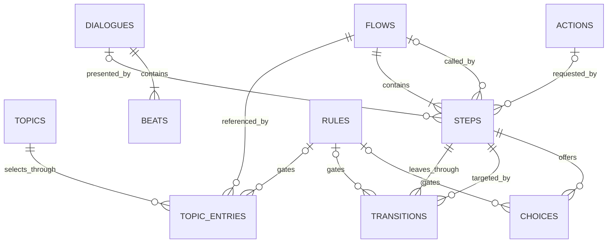
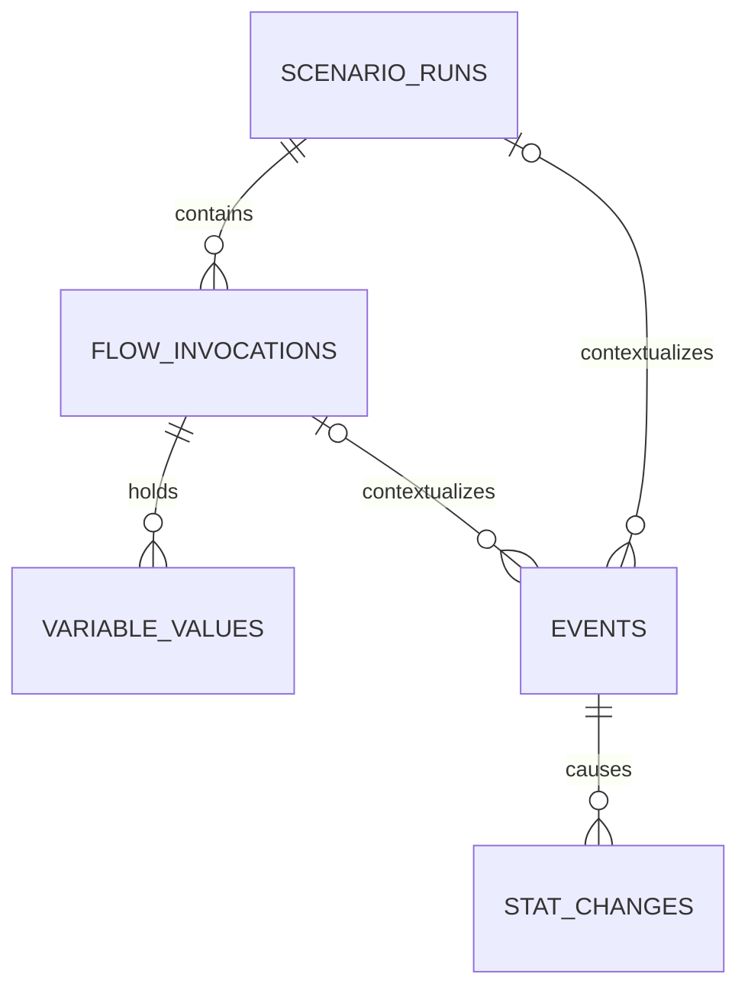

# Dialogue and semantic storage design

> [!important] Consolidated ERD
> [[Content and Interaction ERD]] is now the current relationship/key/ownership
> entry point. This note retains the brainstorming history; early table sketches
> are superseded where the consolidated proposal differs. No implementation START.
> The human approved the consolidated ERD and requested waiting for the database
> foundation report before asking that session to reconcile/integrate the model.

Related: [[Data Management Design]], [[Data Management Implementation Plan]],
[[Topic Scenario Selection]], [[Content Workbench Shared Contract]].

## Decision and scope

Human approved documenting a separate next slice: organize dialogue and embeddings
together; faster lookup is a possible benefit to measure. The concrete schema below
is proposed, not approved implementation or a change to the database worker's task.
Do not migrate the current Resources GTE index or authored JSON during D0-D6.

Historical pre-cutover authoring wording: author in existing JSON/workbench and
compile a validated read-only `content.sqlite3`. The approved SQLite authoring
cutover supersedes the JSON-editable part: shared authored dialogue/drafts are edited
in the revisioned SQLite authoring repository, compiled into an immutable read-only
runtime release, and JSON remains explicit import/export/provenance. Keep private
generated content in writable `personal-content.sqlite3`, never inside the shared
vault. Game history/consumption has since moved under the approved full cutover.

Implementation update2026-10-22: under the approved [[Full SQLite Cutover
Implementation Plan]], P5 added source/headless support for the existing GTE profile
and float32 vectors, an immutable SQL-loaded ranking snapshot, incremental vector
staging, and exact-snapshot publication gating. F1 now routes authored runtime reads
through the pinned SQL release. The installed artifact passed read-only integrity and
trusted-release inspection and matches authoring revision 63; this does not prove
normal startup or player acceptance. The detailed API, coverage, ranking-parity
delta, benchmark, and remaining acceptance gates are in
[[Content Data Integration Handoff]] and
[[../Verification/2026-10-22 Full SQLite Cutover]].

P6 implementation update2026-10-22: game schema 2 adds typed run/invocation/step,
answer, action-checkpoint, event-context and stat-change rows to the existing game
transaction. `GameHistoryReader` pages immutable event/stat/answer history. Scenario
hooks are optional and best-effort; answer option IDs may be retained, free-text bodies
and local variable values are excluded, and no run auto-resumes. See [[Content Data Integration Handoff]] for exact verification and the current source/runtime cutover gap.

## Proposed tables in each content store

> [!warning] Earlier storage sketch, not the final ERD
> The six-table simplification and subsequent reusable-flow decisions below
> supersede treating this first table list as the final schema. Relational
> authoring/runtime boundaries are still being designed; no migration is authorized.

| Table | Principal columns | Responsibility |
| --- | --- | --- |
| content_manifest | schema_version, content_build_id, catalogue_hash, built_at_utc | Format and reproducible bake identity; omit time from deterministic hash |
| topic_revisions | topic_id, revision, route_id, source_hash, schema_version, definition_json | Immutable complete shared-schema Topic document; composite primary key (topic_id, revision) |
| scenario_lookup | topic_id, topic_revision, scenario_id, priority, base_weight, dialogue_ref | Rebuildable scalar projection of Topic document; composite key, not a second editable source |
| anchor_texts | anchor_id, language, text, text_hash | Reusable anchor identity/text; revisions produce new immutable content-addressed IDs |
| anchor_bindings | anchor_id, owner_kind, owner_id, owner_revision, role | Many-to-many ownership: canonical intent/tone/topic or Topic-local anchor; preserve local precedence |
| embedding_spaces | space_id, model_id, model_revision, tokenizer_hash, pipeline_hash, dimensions, dtype, normalization, metric | Full compatibility fingerprint, not merely a model name |
| anchor_embeddings | anchor_id, space_id, vector_blob, vector_hash, created_at_utc | One immutable vector per anchor/space; composite primary key |
| index_manifests | index_id, space_id, anchor_set_hash, matcher_version, build_state | Immutable metadata binding search implementation to an exact vector/mapping set |
| publications | topic_id, topic_revision, index_id, validation_version, validated_hash, published_at_utc | Host-authorized ready revisions; status alone never grants routability |

Shared schema JSON remains the one content representation; EN display, JP speech,
beats, expressions, choices, conditions/actions and replay policy stay there. Do not
normalize every beat into SQL in the first slice. scenario_lookup is generated
from that document and checked for hash consistency; never edited independently.
Its scenario rows are catalogue variants, not active runtime Scenario sessions.
dialogue_ref preserves current embedded/reference semantics rather than inventing
new dialogue IDs or copying payloads inconsistently.

Schema implementation must pin exact existing topic/family/route ID mapping first;
the table vocabulary here does not rename current public IDs. A single-dialogue
Topic remains legal. Uniform namespace-qualified IDs avoid authored/personal
collisions; no implicit personal override of a shipped Topic. Foreign keys apply
inside each store; cross-store IDs use explicit host validation, not fake SQL FKs.
canonical intent/tone owner IDs resolve against existing versioned catalogues;
validate discriminated anchor owners and reject dangling bindings.

## Private workflow additions only

| Table | Principal columns | Responsibility |
| --- | --- | --- |
| generation_jobs | job_id, request_id, state, created_at_utc, last_error_code | Bounded work lifecycle/retry; no credentials or full prompts by default |
| embedding_jobs | job_id, anchor_id, space_id, source_hash, state, attempts | Incremental background embedding; stable idempotency key |

Proposed presentation lifecycle: draft -> validated -> embedding pending -> indexed
-> published, but these are independent checks, not an arbitrary trusted string.
Generated text is untrusted. Validate shared schema, permission-bound actions,
embedding bytes and publication evidence before adding a revision to routable views.
An old published revision stays usable until its replacement is fully ready.

Publish content/reference/index metadata atomically within the owning DB. Build
the matching in-memory index snapshot before advertising that generation to the
router; swap whole snapshots, never expose half-updated mappings. Failure leaves
the last valid published snapshot intact. SQL committed does not mean an in-memory
index loaded or TTS ready. Optional TTS policy remains separate from content readiness.

## Vector representation and queries

Initially preserve current float32 scoring. Store packed little-endian float32 BLOBs,
not decimal text arrays. Require byte count = dimensions * 4, finite values, correct
space fingerprint and expected normalization. Model/tokenizer/pooling changes
create another space, never relabel old vectors. Source hash changes invalidate
dependent derived artifacts. Bake hashing is cached outside GUI repaint/hot paths.

Use SQL indexes for exact Topic/route/scenario/anchor/space/publication lookup.
Content eligibility/priority/weights/consumption stay in existing deterministic
host evaluators; don't duplicate complete gate semantics in SQL. Retrieve weak
candidates for RAG as before; preserve the authored fallback confidence boundary.
SQL storage is not a nearest-neighbor index. Load compatible vectors into the
existing in-memory matcher initially. No vector extension/new search dependency
without measured need and platform verification.

## Consumption and recall references

Content defines repeatability; player-specific consumed/completed state does not
belong in shipped tables. Execution history references store namespace, stable
Topic ID, exact revision, occurrence/instance ID, Scenario ID where applicable,
completion result and time. Preserve whole-Topic consumption and existing completion
timing rules; database row insertion or generated text alone does not consume it.
Validate any retained dialogue reference when content updates remove a definition;
preserve historical IDs/inert records rather than silently reassigning them.
Conversation history and personal-memory lifecycle remain separate.

## Acceptance before switching production

1. Bake from existing authored content, verify full schema/ID/count/hash parity;
   no editable second catalogue and no personal content in the repository.
2. Same phrase/context fixtures produce equivalent candidates, gate/priority/weight
   outcomes, deterministic ties and whole-Topic consumption. Local-only Topics
   and shared-anchor variants are covered.
3. Measure current versus SQLite cold/warm startup, ID lookup, ranking p50/p95,
   allocations/memory, corpus sizes and incremental publish cost on same hardware.
4. Mismatched model/dimensions, corrupt vectors, failed jobs, cancelled publication,
   stale in-memory index and removed definitions fail safely without partial routing.
5. Verify read-only package access on Windows; mobile packaging/access remains a
   separate target test, not assumed from desktop. No production cutover until parity
   and migration/recovery review. Existing JSON/Resources path remains available
   during the isolated spike, with one explicitly selected runtime authority.

No implementation plan or session dispatch for this slice yet. Table counts/names,
query indexes and readiness representation must be refined against the actual shared
Topic/Scenario contract before execution; this note is the future-slice design input.

## ERD brainstorming follow-up: approved concepts

Human approved the following through the ongoing main-session discussion:

- Use plain `metadata`, not `catalogue`, for database/build metadata. Earlier
  topic_revisions/publications/index_manifests separation is not locked SQL design.
- A reusable Dialogue owns ordered Beats and their presentation/localized text.
  Multiple branches/Scenarios reference it. Its caller owns subsequent flow;
  shared speech does not hardcode where every caller goes next.
- Shared edits update all references after validated publication. Already running
  occurrences retain their pinned version. Authoring supports Make independent copy
  and should expose Used by references before shared changes.
- Scenario and reusable Subflow own Steps/transitions. Subflows use explicit
  typed inputs/outputs and named exits mapped back into the caller. No unrestricted
  access to caller-private variables. Reuse never shares invocation progress.
- Conditions support one-off inline checks and explicitly shared Rules, with
  extraction from inline to reusable Rule. One evaluator returns true/false/unknown
  and diagnostics. Unknown is not permission; eligibility is distinct from weight.
- Define an Action once and reference it with validated argument bindings. This
  common boundary covers state-changing interaction operations, including future
  gifting/consumption, but does not implement them in the current DB task.
- Action records describe supported capabilities; registered game executors own
  behavior/effects. Unknown executor means not publishable as executable content.
  Action executions have separate IDs/status/results; narration isn't completion.
- Questions and answer choices belong to flow Steps. Dialogue supplies spoken
  presentation. No hidden state-changing instructions inside spoken Beats.

## First logical ERD proposal

This is a relationship model, not a final SQL migration. Scenario/Subflow may share
one `flows` table with a constrained kind because they use the same step graph;
separate scenario/subflow authoring views can retain clear vocabulary. Current
TopicScenario means content variant, not executable Scenario: an explicit adapter
is required, never reinterpret existing JSON/IDs in place.

The optional Dialogue/Action/called-Flow relationships are exclusive typed
references: a dialogue Step has a Dialogue, an action Step has an Action, a call
Step has a Subflow target. Validation rejects wrong-kind references; this is not
an arbitrary generic target_type/target_id field. Topic entries select Scenarios,
not directly callable Subflows. Named exits and call parameter/output bindings need
their own explicit representation in the physical ERD, still to design.

Transitions bind source and target steps within the same Flow revision; call and
return use declared ports, never cross-graph jumps. A Choice belongs to a question
Step and selects a declared outgoing transition; inline conditions or shared Rules
gate choices with the existing hidden/locked/available semantics and safe reasons.
Topic entries own selection conditions/priority/weights independently of Scenario
execution. Beats are ordered children of Dialogue, not shared individual sentences
initially. Localized text storage remains an upcoming physical-schema decision.

Conditions inline versus referenced must be unambiguous; referenced Rule edits obey
the same published-version policy as other shared definitions. Rule composition
must not introduce recursive evaluation. Flow calls similarly require acyclic
definition references, bounded nesting/expanded graph size and explicit invocation
frames. Exact limits belong to the implementation design, not guessed SQL fields.

Runtime state is a separate model: Scenario run -> invocation frames -> step/action
executions, answers and events. Sharing a definition never shares these records.
Existing policy still ends active/paused Scenario execution on quit; retaining a
history/checkpoint is not permission for automatic next-launch resume.

Next physical-schema decisions: variable/binding representation, condition
trees/Rule composition, named exit mapping, definition revisions/releases and the
bridge to canonical JSON. Only then finalize physical tables/keys/indexes and plan
an isolated parity/bake spike. Current DB worker scope remains D0-D6 unchanged.

## Localization decisions approved during ERD brainstorming

- Language is a row value, not one column per language. Proposed `beat_texts`
  contains beat reference, language and text; unique by Beat revision/language.
  Language codes include `en`, `ja` and `id` (Indonesian, not an identity column).
- Display and speech language are independent presentation settings, defaulting
  to English display and Japanese speech. Other pairings require available text
  and speech-adapter support; schema flexibility does not prove TTS support.
- A Beat retains identity, sequence position and expression; localized texts belong
  to it. Shared edits/revision pinning apply to text rows as well as the parent.
- Player-facing Topic titles, choice labels and other localizable text follow the
  same language-row principle. Exact owner-specific tables versus a reusable text
  resource model remain a physical-schema decision, not a free-form polymorphic FK.
- Missing selected display text falls back to English. If English is also absent,
  content is unavailable with authoring diagnostics, not raw IDs shown to players.
  The latter is a proposed safe default to refine at validation time.
- Missing selected speech translation means skip speech, not silently choose a
  different language or start an unapproved translation/model call. Normal text
  presentation remains usable. This fallback policy was explicitly accepted.
- Speech cache identity includes finalized text, language and voice/provider
  configuration; existing cache implementations are not claimed compatible yet.

These are target-schema decisions, not migration of the current bilingual
`text`/`displayText` runtime/provider contracts. Explicit adapters, validation and
parity tests must precede any cutover. Existing database session scope is unchanged.

## Approved execution variables, events and stat causes

Human explicitly approved the local-variable/event correlation design after the
examples below. These are logical contracts; exact SQL columns/retention limits
and compatibility with the existing game repository remain implementation design.

### Four distinct kinds of information

- Local variable: typed working data for one Scenario run or Subflow invocation,
  for example drawing_subject, selected_desk, accepted or current_stage. Definition
  contracts are shared; invocation values are not. No arbitrary executable expressions
  or SQL. Supported scalar/enum/entity-reference types require host validation.
- Stat: current character/player/environment state, mutated only through game rules.
- Event: host-confirmed experience/outcome with durable meaning and provenance.
- Personal memory: permitted retained/recalled information under memory/privacy
  policy, not automatic promotion of local variables or all gameplay history.

Local values remain available while the occurrence runs or is paused. On end/quit
they stop being active; they do not become persistent character traits or cause
automatic Scenario resume. A bounded diagnostic trace may be retained separately.
Durable variable checkpoints, if used for crash diagnostics, do not override the
existing end-on-quit lifecycle. Exact cleanup timing is not yet selected.

### Correlation ERD

Scenario and invocation IDs correlate records; they do not prove causation.
Action-related events additionally reference the exact Action execution/operation
when applicable. Autonomous actions can emit events without Scenario references.
The root Scenario execution has its own invocation frame; Subflow calls get distinct
frames and explicit input/output bindings.

Events store explicitly selected historical details themselves, not foreign keys to
temporary variable values. A drawing-completed event may retain subject=car even
after working variables are cleared or changed to cat. Do not dump all variables,
free text or inferred sensitive facts into event payloads. Events/current stats and
personal memory keep their existing privacy/AI-sharing boundaries.

Historical event references must survive variable cleanup. Physical SQL must not
use cascaded deletion that erases events/stat causes when runtime details expire;
retain minimal run/invocation identities or explicitly detach optional references
while preserving stable correlation IDs according to the future retention design.

### Meaningful interactions and actual effects

- item_presented is confirmed delivery of the presentation interaction to Alterra,
  not highlighting an inventory item or merely entering a presentation preview.
- gift_accepted, gift_declined and deferred outcomes are distinct. Presentation
  alone does not transfer ownership, consume an item or award relationship effects.
- activity_started and activity_completed are distinct; consent/intention is not
  proof of physical completion. Include exact item/actor/action identities and UTC
  timestamps where relevant. Ownership transfer, its event and authorized discrete
  effects commit together; a failed operation must not publish success.
- One event can cause zero or many stat_changes. Each records actor/stat identity,
  actual before/after values and applied delta where meaningful, with its causing
  event ID. Clamp-aware example: 95 -> 100 means +5, not the requested +10.
  Unknown state stays unknown; do not fabricate before values for the log.
- Continuous decay/recovery is aggregated over bounded intervals, retaining rule
  identity/version and interval information. Do not create one row per frame or
  tiny fluctuation. Interval/retention policy must be settled with the simulator.
- Debug traces are bounded diagnostics, not permanent memory. Current-state tables
  remain authoritative; no full event-sourcing/replay requirement is introduced.

Events may be selected for permitted agent recall; recording an event does not
authorize provider transmission. These decisions refine the future history/content
ERD, not authorization to expand the active database worker's D0-D6 implementation.

## Approved typed parameters, bindings and exits

Human approved this contract as the next ERD design bundle:

- Flows declare named inputs/outputs with supported type, required flag and optional
  type-checked default. Types: text, boolean, integer, number, constrained enum and
  typed entity reference (actor/item/furniture/use-point as applicable).
- An absent optional value is not false, zero or empty text. World-evidence unknown
  stays distinct from known values. Specific null/unknown wire representation is
  not selected by this approval.
- Explicit input bindings can use a literal, caller input/local, permitted host
  context or validated earlier Action result. No SQL, arbitrary expressions or
  access to other flows' private variables. Entity existence/eligibility is checked
  again at use, not trusted forever after an initial binding.
- Subflows declare named exits such as accepted/declined/cancelled. Every declared
  exit must have an explicit mapping at each call site; a missing map is invalid.
  These illustrative names are not a mandatory vocabulary for every Subflow.
- Callers explicitly map outputs into caller-local variables. Only valid outputs
  for the return exit are exposed; cancellation cannot leak partially produced
  values. Accepting an invitation is not activity completion or a game effect.
- Proposed table responsibilities: flow_parameters, step_bindings, flow_exits and
  exit_mappings, plus per-invocation variable values. Names, discriminated binding
  columns and FK/version constraints still need physical-schema review.

Example: offer_drawing receives activity_name=drawing, returns selected_subject=car
through accepted, and the caller chooses its desk/action steps. It does not set
world stats or take ownership of a desk merely by returning an entity reference.

## Approved publication bundle policy

Human approved versioned publication bundles. Shared edits create draft revisions;
publication validates references/dependents. New interactions use the published
bundle and already-running interactions retain their pinned revisions. Keep old
revisions while referenced; garbage collection cannot break history. Authored
content initially publishes as one validated build; generated content may publish
a smaller complete dependency bundle without rebaking the authored catalogue.
Changing Subflow exit names requires valid updated caller mappings before publish.
Exact bundle/revision/dependency SQL is still to design, not an implemented release
manager or permission to update executor code from content.

## Approved opt-in recording and manual contribution

Human wants both local personalization and opt-in contributions to improve AlterOS.
Approved collection/delivery flow: enable local recording -> record eligible
interactions while enabled -> explicit Contribute -> preview/select batch -> confirm
upload -> server acknowledgment. No automatic background uploads. This is separate
from ordinary required game persistence and personal-memory/provider permissions.

- Recording starts from opt-in, not retroactive extraction from old history.
- Eligible interaction evidence includes submitted input (not keystrokes/drafts),
  actual options shown/order/availability and selection, routing/candidate scores
  and revisions, beat presentation acknowledgments, actual Action outcomes,
  explicit feedback and bounded latency/error diagnostics. Exact per-field capture
  consent/redaction rules remain implementation design; this is not unlimited
  collection of OS activity, credentials, all local variables or all private history.
- Recording off stops new optional collection. Existing recorded data may be
  reviewed/deleted/contributed until bounded retention expires. Exact duration is
  unresolved. Essential state/events persist independently; no contribution required
  for gameplay or authorized local personalization.
- Contribute preview shows date range, record count and whether conversation text
  is included. Default selection is uncontributed records since the previous
  contribution, with editable range and exclusions. Use explicit record membership
  and successful receipts, not a timestamp cursor that could lose excluded records.
- Confirm freezes the exact permitted batch. Only successful server acknowledgment
  marks receipt; retry is idempotent and does not submit unrelated new records.
  Error/offline/cancel states cannot pretend delivery. Transmission already accepted
  cannot be described as unsent; server-side deletion/withdrawal needs its own policy.
- Intended contribution purpose is disclosed. Sharing for diagnostics/evaluation
  does not automatically authorize training. Consent to personal memory is not
  permission to contribute, and contribution is not permission for arbitrary AI
  provider transmission. Imported local text/telemetry is untrusted evidence.
- Observations are not golden labels: ignored/skipped choices do not prove dislike,
  and selecting an option does not prove correct routing or successful activity.
- Never promise anonymity merely because direct names are omitted. Conversation
  text and combinations of identifiers/timestamps may remain identifying.

Proposed additional entities (not SQL implementation):

| Entity | Responsibility |
| --- | --- |
| recording_sessions | Enabled intervals, collection scope and consent-policy revision |
| interaction_records | Local observations, correlated to turns/runs/events without becoming another gameplay authority |
| contributions | Immutable approved batch/purpose, upload status and acknowledged receipt |
| contribution_records | Exact record membership; payload revision/hash distinguishes what was actually sent |

Use the existing consent owner where possible rather than introduce contradictory
consent booleans. Optional recording retention/deletion must not erase required
inventory facts, and game-history retention is not an excuse to retain deleted
optional raw text. Privacy review, deletion propagation/backup interaction, backend
endpoint/authentication, payload limits, retention periods and training contribution
policy are unresolved future work. No network endpoint, capture or upload enabled
by these notes; current database worker D0-D6 scope remains unchanged.
